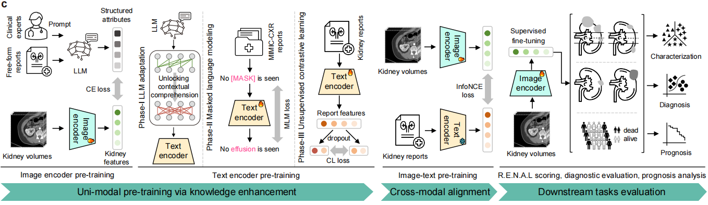
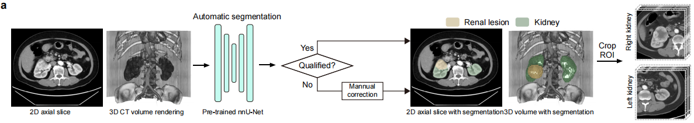
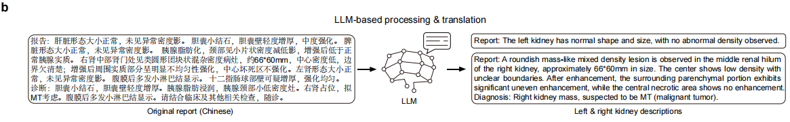

# RenalCLIP: A Disease-Centric Vision-Language Foundation Model for Precision Oncology in Kidney Cancer

[](https://www.nature.com/articles/s41467-026-74175-w)
[](https://arxiv.org/abs/2508.16569)
[](https://huggingface.co/taoyh/RenalCLIP)

🎉 **RenalCLIP has been published in [Nature Communications](https://www.nature.com/articles/s41467-026-74175-w)!**

This repository contains the official implementation of RenalCLIP, presented in our paper, "[A disease-centric vision-language foundation model for precision oncology in kidney cancer](https://www.nature.com/articles/s41467-026-74175-w)", published in *Nature Communications*.

Our work introduces **RenalCLIP**, a vision-language foundation model specifically designed for the comprehensive assessment of renal masses from CT imaging. By leveraging a novel, two-stage knowledge-enhancement pre-training strategy on a large-scale, multi-center dataset, RenalCLIP learns a deeply contextualized representation of kidney cancer.

## Corrections - 16 November 2026

- [Corrected Source Data (Excel)](2026-11-16-correction/Source_Data_corrected.xlsx?raw=true): aligns Figure 3b metrics with the reported Youden thresholds, corrects the Nomogram confidence interval, adds RFS event indicators, and restores full-precision risk scores.
- [Corrected Figure 5 (PDF)](2026-11-16-correction/Figure5_corrected.pdf?raw=true): corrects the image-to-text recall axis and plot geometry in panel a.
- [Corrected Supplementary Table 25 (PDF)](2026-11-16-correction/Table_S25_corrected.pdf?raw=true): reports endpoint-specific median risk-score thresholds and eligible sample sizes, including the corrected Xiamen/Merlin/RFS cutoff.

We thank Alberto Zambudio-Munuera and colleagues for identifying the discrepancy between the main-text operating-point metrics and the Figure 3b Source Data in their review, [The Translation Gap in Artificial Intelligence-Based Renal Mass Characterization: A Narrative Review](https://www.mdpi.com/2072-6694/18/22/3637). Their careful examination prompted the broader consistency checks and corrections listed above.

These are author-supplied updates. We will contact the publisher. They do not replace a journal-issued correction.

## News

* **2026-07-27:** The version of record was published in *Nature Communications*.
* **2026-06-08:** The article was published online.
* **2026-06-01:** The paper was accepted by *Nature Communications*.
* **2025-08-22:** The preprint was released on [arXiv](https://arxiv.org/abs/2508.16569).



## Model Zoo & Checkpoints

All official pre-trained model weights for both the **Image Encoder** and the **Text Encoder (LLM2Vec)** are publicly available on our Hugging Face repository.

* **Hugging Face Repo:** [**https://huggingface.co/taoyh/RenalCLIP**](https://huggingface.co/taoyh/RenalCLIP)

Please refer to the repository card on Hugging Face for details on each specific checkpoint file.

## Installation

Before you start, please set up the environment with all necessary dependencies.

1.  **Clone the repository:**
    ```bash
    git clone https://github.com/dt-yuhui/RenalCLIP.git
    cd RenalCLIP
    ```

2.  **Install dependencies:**
    We recommend using a virtual environment (e.g., conda). All required packages are listed in `requirements.txt`.
    ```bash
    pip install -r requirements.txt
    ```

**Hardware Requirements:** The pre-training and fine-tuning experiments were conducted on NVIDIA A100 80GB GPUs. While most downstream fine-tuning and inference can be run on a single A100 GPU, the cross-modal pre-training stage requires a multi-GPU setup (e.g., 4 x A100 80GB).

## Data Preparation

### 1. CT Preprocessing
Our model takes single-kidney 3D volumes as input. The preprocessing pipeline involves two main steps:

* **Automated Segmentation:** We first use the pre-trained **nnU-Net** model to automatically segment the kidneys and renal lesions from the original CT scans. For details on nnU-Net, please refer to their official repository: [https://github.com/MIC-DKFZ/nnUNet](https://github.com/MIC-DKFZ/nnUNet). An example command is:
    ```bash
    nnUNet_predict -i INPUT_FOLDER -o OUTPUT_FOLDER -t 135 -m 3d_lowres
    ```
* **ROI Cropping:** Based on the generated segmentation masks, we then perform ROI cropping and other offline preprocessing. The implementation details can be found in the Jupyter notebooks within the `preprocessing/` directory, such as `CropOneKidney.ipynb` and `CropOfflinePreprocess.ipynb`.



### 2. Report Preprocessing
The original Chinese radiology reports are first parsed by an LLM to separate descriptions pertaining to the left and right kidneys, and then translated into English. Details can be found in our paper's **Methods section**.



## Pre-training RenalCLIP
The pre-training process consists of two main stages. 

### 1. Uni-modal Pre-training via Knowledge Enhancement

* **Image Encoder:** The 3D ResNet-18 image encoder is pre-trained using a multi-task learning framework on structured pathological attributes. These attributes were systematically extracted from radiology reports as detailed in our paper's **Methods section**. To run this stage, use the script:
    ```bash
    bash scripts/run_downstream_img_mt-pretrain.sh
    ```
* **Text Encoder:** The Llama3-based text encoder is pre-trained using the **[LLM2Vec](https://github.com/McGill-NLP/llm2vec)** methodology, which involves MNTP training on MIMIC-CXR followed by unsupervised contrastive training (SimCSE) on our pre-training corpus.

### 2. Cross-modal Pre-training

After uni-modal pre-training, the two encoders are jointly trained for vision-language alignment. This stage requires a multi-GPU setup. To run cross-modal pre-training, use the script:
```bash
bash scripts/run_clip.sh
```

## Downstream Task Evaluation

All downstream tasks are fine-tuned and evaluated on a single 80GB A100 GPU. The running scripts for all tasks are located in the `scripts/` directory.

### 1. Clinical Workflow Tasks (Fine-tuning)

* **Anatomical Characterization (R.E.N.A.L. Score):**
    * `run_downstream_Renal_R.sh`, `run_downstream_Renal_E.sh`, `run_downstream_Renal_N.sh`, `run_downstream_Renal_A.sh`, `run_downstream_Renal_L.sh`
* **Diagnosis (Malignancy & Aggressiveness):**
    * `run_downstream_BMC.sh` (Malignancy), `run_downstream_IC.sh` (Aggressiveness/Invasiveness)
* **Prognosis (Survival Prediction):**
    * `run_downstream_survival_RFS.sh`
* **Multi-phase Fusion Example:**
    * The script `run_downstream_BMC_fusion.sh` demonstrates how to perform the multi-phase late-fusion strategy for the diagnosis task.

### 2. Advanced Capability Tasks

For zero-shot and retrieval tasks, we pre-compute the image and text embeddings offline for efficiency. Please refer to the notebooks in `preprocessing/`, such as `get_img_embed_offline.ipynb.ipynb`,  `get_zeroshot_txt_embed_offline.ipynb.ipynb`, and `get_retrieval_txt_embed_offline.ipynb`.

* **Zero-shot Classification:**
    * Run with `scripts/run_downstream_img_zeroshot.sh`. This script supports both the deterministic maximum similarity and the stochastic prompt sampling strategies.
* **Cross-modal Retrieval:**
    * Run with `scripts/run_downstream_img_retrieval.sh`.
* **Report Generation:**
    * Run with `scripts/run_downstream_caption.sh`.

## Citation

If you find RenalCLIP useful in your research, please cite our paper:

```bibtex
@article{Tao2026RenalCLIP,
  title   = {A disease-centric vision-language foundation model for precision oncology in kidney cancer},
  author  = {Tao, Yuhui and Zhao, Zhongwei and Wang, Zilong and Luo, Xufang and Chen, Feng and Wang, Kang and Wu, Chuanfu and Zhang, Xue and Zhang, Shaoting and Yao, Jiaxi and Jin, Xingwei and Jiang, Xinyang and Yang, Yifan and Li, Dongsheng and Qiu, Lili and Shao, Zhiqiang and Guo, Jianming and Yu, Nengwang and Xiong, Ying and Wang, Shuo},
  journal = {Nature Communications},
  volume  = {17},
  pages   = {7313},
  year    = {2026},
  doi     = {10.1038/s41467-026-74175-w},
  url     = {https://doi.org/10.1038/s41467-026-74175-w}
}
```

* **Paper:** [Nature Communications](https://www.nature.com/articles/s41467-026-74175-w)
* **Preprint:** [arXiv:2508.16569](https://arxiv.org/abs/2508.16569)
